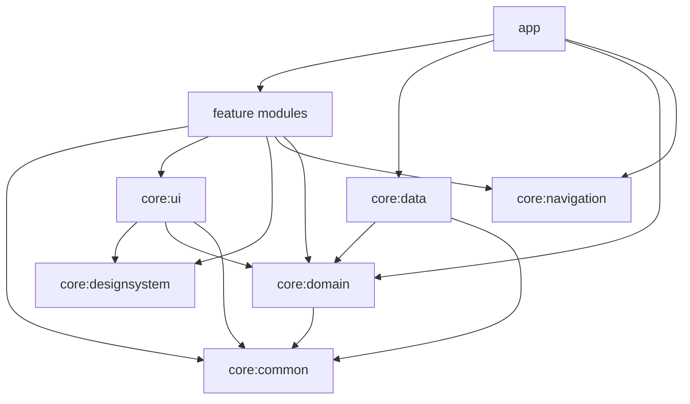

# Tectonic

An Android implementation of **Tectonic** (also known as Suguru), the logic puzzle played on a grid of irregular regions. Built with Kotlin, Jetpack Compose and Clean Architecture, with a puzzle generator and solver written from scratch.

## Demo     
[A short gameplay walkthrough.](https://github.com/user-attachments/assets/498b6eeb-7ff0-42bb-8fb4-eee83e7c237f)

## The puzzle

The board is divided into regions. Fill every cell with a number so that:

1. A region of *n* cells contains each of the numbers 1 to *n* exactly once.
2. No two equal numbers touch, including diagonally.

Every puzzle this app serves has exactly one solution.

## Highlights

- **Constructive puzzle generator.** Regions and values are built together, so every layout is solvable by construction. Generation is deterministic for a given seed and difficulty.
- **Propagation-based solver.** Bitmask candidates with naked-single and hidden-single deduction, plus backtracking only when logic runs out. It doubles as the uniqueness checker and the difficulty gate.
- **Pure-Kotlin domain.** The domain module has no Android dependencies, so generation, solving and game rules run and test on a plain JVM.
- **Strict module boundaries.** A multi-module Gradle build with one-way dependencies; features never depend on each other.
- **Navigation 3 with decentralized routing.** Each feature contributes its own destinations through Hilt multibindings.
- **Adaptive visual design.** Region colors are assigned by graph coloring so neighboring regions never share a hue, in both light and dark themes.

## Architecture



| Module | Responsibility |
| --- | --- |
| `app` | Application entry point, Hilt wiring, navigation host. |
| `core:common` | `TecResult`, `AppError` and other primitives shared by every layer. |
| `core:domain` | Models, repository interfaces, use cases, and the generator, solver and validators. Pure JVM. |
| `core:data` | Room database, mappers and repository implementations. |
| `core:designsystem` | Theme, color tokens, typography and reusable components. |
| `core:ui` | Shared UI building blocks: the puzzle board, text and format helpers, error mapping. |
| `core:navigation` | Navigation keys and the navigator contract. |
| `feature:home` | Play or continue, difficulty selection, links to history and statistics. |
| `feature:puzzle` | The game screen. |
| `feature:history` | Finished games grouped by date with personal-best badges, and a review of any past board with a result summary, a comparison to your best and average, and Play again. |
| `feature:statistics` | Overview, per-difficulty solve times, daily streaks and a recent-times chart, filterable by difficulty. |

### Conventions

- **Dependency rule.** `domain` depends only on `common`. `data` and the features depend inward on `domain`; nothing depends on `app`.
- **Errors as values.** Operations return `TecResult<T>` carrying a typed `AppError`; exceptions are caught at the data boundary instead of leaking upward.
- **Contract-based presentation.** Each screen has a contract of `UiState` and `Action` types. A `ViewModel` exposes a single `StateFlow`; one-shot events exist only where navigation needs them. Screens are split into a stateful `Screen` and a stateless, previewable `Content`.
- **Use cases.** Plain classes without framework annotations, wired together in `app` so the domain stays free of DI libraries.
- **Navigation.** `AppNavKey` is a sealed, serializable key set in `core:navigation`. Each feature registers its entries as a `TectonicEntryProviderInstaller` into a Hilt set, so adding a screen never touches a central router.

## Design decisions

### Why the generator builds regions and values together

Generating a random region layout and then solving it fails almost every time. Each region contains exactly one `1`, and equal values cannot touch, so the 1s form an independent set on the grid's king-move graph. On an 8×8 board that caps the layout at 16 regions, which forces an average region size of at least four cells. Random layouts violate this constantly.

The generator avoids the problem by placing a region and assigning its values in one backtracking step. The layout is valid by construction and never needs repair.

### Many cheap attempts beat one long one

Backtracking on larger boards has a heavy tail: most attempts finish in milliseconds, a few run away. Each construction attempt gets a small node budget (5,000) and the generator simply restarts. On a desktop JVM across 150 seeds per difficulty, every puzzle was valid, unique and reproducible, with the 8×8 tier averaging about 50 ms and peaking near 330 ms.

Limits are node counts, never wall-clock time, which keeps generation deterministic. All randomness comes from one seeded `Random`.

### The solver is also the quality gate

The solver keeps a candidate bitmask per cell and applies two deductions until nothing changes: a cell with one candidate left, and a value that fits only one cell of its region. It branches (most constrained cell first) only when both stall.

Clues are then removed one at a time, and a removal is kept only if the puzzle stays acceptable:

- Uniqueness is checked by counting solutions with a limit of two.
- **Easy** and **Medium** additionally require the puzzle to be solvable by deduction alone, so they never force a guess.
- **Hard** only requires uniqueness.

### Difficulty

| Tier | Grid | Clues kept | Solving |
| --- | --- | --- | --- |
| Easy | 5×5 | 55–72% | Logic only |
| Medium | 6×6 | 40–55% | Logic only |
| Hard | 8×8 | 28–40% | Unique solution, guessing allowed |


## Tech stack

| Area | Choice |
| --- | --- |
| Language | Kotlin |
| UI | Jetpack Compose, Material 3 |
| Navigation | Navigation 3 |
| DI | Hilt |
| Persistence | Room, DataStore for the session |

## Build and run

Requirements: JDK 17, a recent Android Studio, and an Android SDK with API 37 installed. The app supports Android 9 (API 28) and up.

```bash
./gradlew assembleDebug     # build the debug APK
./gradlew installDebug      # install on a connected device or emulator
./gradlew test              # run JVM unit tests
```

Because `core:domain` is plain Kotlin/JVM, its tests run without an emulator, for example `./gradlew :core:domain:test`.

## License

Released under the [MIT License](LICENSE).
